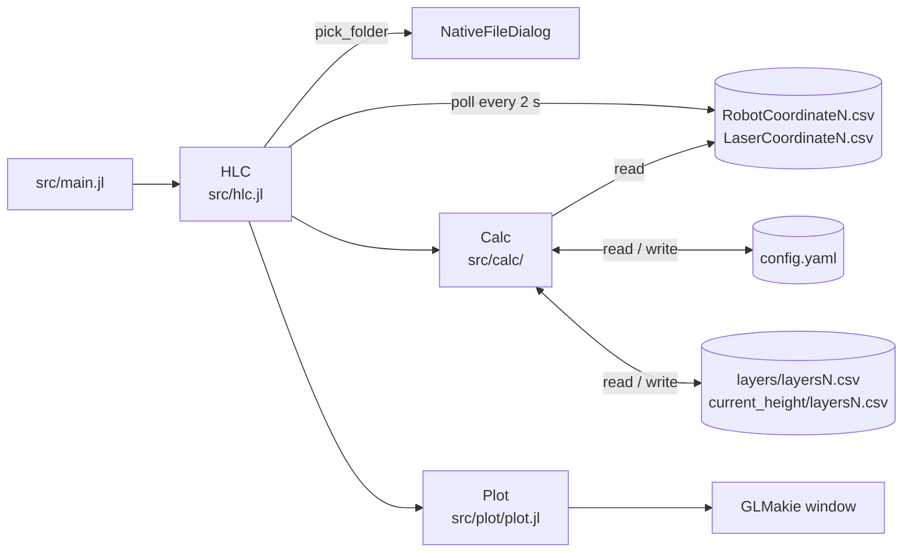

# HLC documentation

HLC (Height Layer Calculation) is a Julia desktop program for Wire Arc Additive
Manufacturing (WAAM). It watches a folder for pairs of CSV files, one with robot
poses and one with laser line scanner profiles, turns each pair into a point
cloud in world coordinates, and plots the height of each deposited layer and its
change from the previous layer (`README.md:3-7`, `src/hlc.jl`). The course
write-up names the users as Additive Lab employees who monitor the printing
process (`docs/Application development ... WAAM method.pdf`, p. 8). A Python port
of the same pipeline is in `python/`.

The requirements reverse-engineered from the code are in [`../SPEC.md`](../SPEC.md).

## 1. Status

| Item | State | Source |
| --- | --- | --- |
| Documented commit | `8c54e5b`, 2026-11-08, tag `v1.0.0`, branch `release` | `git log -1`, `git tag` |
| Last change to the project's own code | `1f8808c`, 2025-04-30, "add python + add laser range" (`src/`, `python/*.py`, `test/`, `config.yaml`, `metrics_collector.jl`). `plantuml/` last changed in `140d777`, 2025-05-06 | `git log -1 -- <path>` |
| Later commits | 2026-04 to 2026-11: README, the write-up PDF and images, licence, `.gitignore`, removal of committed `.pyc` files, and the lab tooling. No change to program logic | `git log` |
| Version | `1.0.0` | `recipe.ps1:11` |
| Automated tests | `test/runtests.jl` exists but cannot run: it loads module `Calculation`, and the code defines `Calc` | `test/runtests.jl:13`, `src/calc/calc.jl:2` |
| Python tests | none | `git ls-files` |
| CI | Five Gitea workflows under `.gitea/workflows/`; three of them (`propose`, `test`, `release-gate`) call `recipe.ps1 test`, which checks only `.claude/`. No CI step builds, runs or tests the Julia or Python code | `recipe.ps1:41-55`, `.gitea/workflows/propose.yaml:146`, `test.yaml:56`, `release-gate.yaml:51` |
| Dependency pinning | No `Project.toml`; `Manifest.toml` is gitignored; `python/requirements.txt` has no versions | `README.md:52-53`, `.gitignore:37`, `python/requirements.txt` |

Evidently unfinished: the test suite (see above), the plane edge selection
(`num_points_edge` is ignored, `src/calc/plane.jl:25-26`), the `plane.exist` flag
(never set by the Julia code), and the Python port (its config save empties
`config.yaml`, and it calls `math` and `Points` without importing them, see
section 8).

## 2. Layout

| Path | What it is |
| --- | --- |
| `src/main.jl` | Entry point: includes `hlc.jl` and calls `HLC.run()` |
| `src/hlc.jl` | Module `HLC`: folder dialog, polling loop, per-scan orchestration |
| `src/calc/calc.jl` | Module `Calc`, includes the four files below |
| `src/calc/config.jl` | `AppConfig` structs, `load_config`, `save_config` for `config.yaml` |
| `src/calc/points.jl` | `RobotRow`, `LaserRow`, `Point`; CSV parsing; Euler-to-matrix transforms; world-point calculation |
| `src/calc/plane.jl` | Plane fit by SVD, filter by plane distance, laser X-range filter |
| `src/calc/heiht.jl` | `Height`; representative point per profile, grid interpolation, height and delta-height files (file name spelled `heiht`) |
| `src/plot/plot.jl` | Module `Plot`: one GLMakie figure with three axes |
| `config.yaml` | Laser calibration, laser X range, base plane and grid parameters; rewritten at run time |
| `python/` | Python port: `main.py`, `hlc.py`, `config.py`, `points.py`, `plane.py`, `height.py`, `plot.py`, its own `config.yaml`, `requirements.txt` |
| `test/runtests.jl` | Julia test suite for helpers, CSV, transforms and point calculation (does not run) |
| `test/test_adder.jl`, `test/test_cleaner.jl` | Helper scripts that copy or delete scan files in hard-coded absolute Windows folders |
| `test/test_interp.jl` | Standalone example of nearest-pair matching with NearestNeighbors; not used by `src/` |
| `test/README.md` | Manual test procedure |
| `metrics_collector.jl` | Counts lines, comment lines, structs and functions in `src/` |
| `plantuml/` | Use case, component, two class and four monitoring diagrams (`.wsd`) |
| `docs/` | Course write-up PDF and three images used by the root README |

## 3. Architecture



Data flow for one scan index `N` (`src/hlc.jl:85-170`). Index `N` is processed
when both files of index `N+1` exist, so the last pair of a run is never
processed:

1. Read both CSV files and keep laser points whose laser-frame X lies in
   `[laser_min_x, laser_max_x]` (`src/hlc.jl:113-115`, `src/calc/plane.jl:138-158`).
2. Convert every laser point to world coordinates:
   `T(robot pose) * T(calibration) * [x, 0, z, 1]`, ZYX Euler angles in degrees.
   Robot and laser rows are paired by row number, not by time
   (`src/calc/points.jl:593-696`).
3. Index 1 (the base): fit a plane through all points by SVD, write `A, B, C, D`
   to `config.yaml`, plot the cloud in red (`src/hlc.jl:121-126`,
   `src/calc/plane.jl:17-92`).
4. Index 2 and later: reduce each laser profile to one point (line fit through
   its 20 lowest-Z points), convert to world, drop points within `StdZ` of the
   plane (`src/calc/heiht.jl:211-250`, `src/calc/plane.jl:105-136`).
5. Index 2 only: store the first and last remaining points as grid ends `p0`,
   `p1` in `config.yaml` (`src/calc/heiht.jl:154-164`).
6. Interpolate Z linearly along the dominant axis onto `scans` steps between
   `p0` and `p1` (`src/calc/heiht.jl:253-348`).
7. Write the height above the plane to `current_height/layers{n}.csv`, and the
   change from the previous layer to `layers/layers{n}.csv`, where n counts the
   processed layers (n = N - 1 for a run started on an empty folder); plot both
   and the cloud (`src/calc/heiht.jl:350-495`, `src/hlc.jl:142-148`).

External parts: the robot and scanner software that writes the CSV files is not
in this repository; the code only reads the files. GLMakie needs an OpenGL
window: `src/plot/plot.jl:9-16` queries the primary monitor when the module
loads.

Python port (`python/`): the same steps with tkinter, pandas, SciPy and
matplotlib. Differences found in the code: it processes pairs already present at
start (`python/hlc.py:192-193`), has no laser X-range filter (no `laser_min_x`
in `python/`), and requires `plane.exist: true`, which its `calculate_plane` sets
(`python/plane.py:103`, `python/hlc.py:88`) but cannot save (section 8).

## 4. Build and run

Prerequisites:

- Julia. No version is stated in any file (no `Project.toml`).
- Julia packages, from the `using` lines: NativeFileDialog (`src/hlc.jl:5`),
  YAML, OrderedCollections (`src/calc/config.jl:2-4`), CSV, DataFrames
  (`src/calc/points.jl:4-5`), Optim, Interpolations, ScatteredInterpolation
  (`src/calc/heiht.jl:7-9`), Makie, GLMakie, Colors (`src/plot/plot.jl:4-5`).
  The tests also use NearestNeighbors and StaticArrays (`test/test_interp.jl:3-4`).
  The repository has no install command for them.
- A display with OpenGL for GLMakie (inference from `src/plot/plot.jl:9-16`).
- Declared in the write-up, not checked by code: Windows 10/11, 8 GB RAM, x64,
  1 GB free disk (PDF p. 7).

Run (`README.md:44-46`):

```bash
julia src/main.jl
```

`config.yaml` is opened by relative name (`src/calc/config.jl:46`), so the
working directory decides which file is read and rewritten. Running from the
repository root uses the root `config.yaml` (inference from the code).

Python port: dependencies are listed without versions in
`python/requirements.txt` (numpy, PyYAML, pandas, scipy, matplotlib); tkinter is
also imported (`python/hlc.py:18-19`). The entry point is `python/main.py`. The
repository documents no install or run command for it.

## 5. Configuration

No environment variables and no command-line flags are read by the project's
code. `recipe.ps1:28-38` loads `.claude/.env`, but only for the tooling.

`config.yaml` (all keys are required by the Julia loader, `src/calc/config.jl:72-88`):

| Key | Meaning | Written by the program |
| --- | --- | --- |
| `calibration.x`, `.y`, `.z` | Translation of the laser frame in the robot pose frame (used as `T_robot_laser`, `src/calc/points.jl:597`) | no |
| `calibration.a`, `.b`, `.c` | Rotation of the same frame, degrees, mapped to `rx`, `ry`, `rz` (`src/hlc.jl:80-84`) | no |
| `calibration.laser_min_x`, `.laser_max_x` | Laser-frame X range of points kept (`src/calc/plane.jl:138-158`) | no |
| `plane.exist` | Saved and loaded; not read by the Julia logic. The Python port requires `true` | no (Julia); attempted by Python, the save fails (section 8) |
| `plane.A`, `.B`, `.C`, `.D` | Base plane `Ax + By + Cz + D = 0` | yes, at index 1 |
| `plane.StdZ` | Points closer to the plane than this are dropped | no |
| `plane.p0`, `plane.p1` (`x`, `y`) | Grid ends | yes, at index 2 |
| `plane.scans` | Number of grid steps between `p0` and `p1` | no |

`python/config.yaml` has the same keys except `laser_min_x` and `laser_max_x`.
Python defaults exist in the dataclasses (`python/config.py:10-43`), but its
loader also requires every key (`python/config.py:76-97`).

Fixed in code: poll interval 2 s (`src/hlc.jl:219`), 20 lowest points per
profile (`src/calc/heiht.jl:211`), 500 ms timestamp warning threshold
(`src/calc/points.jl:671`), output folder names `layers` and `current_height`
(`src/hlc.jl:30-38`).

## 6. Usage

Live monitoring (`src/hlc.jl:193-219`, write-up p. 17):

1. Start the program; a native folder dialog opens. Cancel exits.
2. The program deletes and recreates `layers/` and `current_height/` inside the
   chosen folder (`src/hlc.jl:30-38`).
3. Complete pairs already in the folder are counted but not processed, except
   the highest one (`src/hlc.jl:45-66`, section 8).
4. As `RobotCoordinate{N}.csv` and `LaserCoordinate{N}.csv` appear, pair `N-1`
   is processed and the window is updated. The first processed pair is taken as
   the bare base, the second as the first layer.
5. Ctrl+C stops the loop (`src/hlc.jl:172-182`).

Replay of recorded scans: `test/README.md` describes copying the pairs one by
one into the watched folder and waiting for the plots. The recorded scans are
not in the repository (`*.csv` is ignored, `.gitignore:39`).

Input formats (from the parsers):

| File | Columns | Source |
| --- | --- | --- |
| `RobotCoordinate{N}.csv` | `TimeReceived, X, Y, Z, RX, RY, RZ` | `src/calc/points.jl:316-382` |
| `LaserCoordinate{N}.csv` | `TimeReceived, X, Z, Intensity`; `X`, `Z`, `Intensity` each hold space-separated values of one profile | `src/calc/points.jl:221-287` |

`TimeReceived` is parsed as `yyyy-mm-ddTHH:MM:SS.s` or `yyyy-mm-dd HH:MM:SS.s`
(`src/calc/points.jl:99-105`).

Outputs: `layers/layersN.csv` and `current_height/layersN.csv`, header
`x,y,z,r,h`, one row per grid point (`src/calc/heiht.jl:379-385`, `487-492`).

Code metrics: `metrics_collector.jl` walks `src/` and must be started from the
repository root (`metrics_collector.jl:118-122`).

## 7. Testing

- `test/runtests.jl` has testsets "Helper Functions", "CSV Handling",
  "Transformation Logic" and "Point Calculation". They cover
  `_parse_delimited_array`, `_format_delimited_array`, CSV read and write of
  `RobotRow` and `LaserRow`, `euler_to_transform_y`, `transform_to_euler_y`,
  `calculate_points_row` and `calculate_points`. Nothing covers the plane, the
  height grid, the files in `layers/`, the monitor loop or plotting.
- The suite stops at `using ..Calculation` (`test/runtests.jl:13`). Even with the
  module name fixed, `test/runtests.jl:81` expects a space between date and
  time, while `data_to_csv` writes a `T` (`src/calc/points.jl:401`), so that test
  would fail (inference, not run).
- Manual test: `test/README.md`. Its step 1 says `julia HLC.jl`; the repository
  has `src/hlc.jl`, which only defines the module and does not call `run()`.
  The entry point is `src/main.jl`.
- `.\recipe.ps1 test` runs pytest and ruff over `.claude/` only (`recipe.ps1:45-53`).

## 8. Known limitations and problems

Behaviour of the code:

- The last pair of a run is never processed: index `N` waits for `N+1`
  (`src/hlc.jl:102-113`).
- Pairs present at start are skipped, except the highest one, which is processed
  when the next pair arrives. Then the plane comes from the previous run's
  `config.yaml` unless that highest pair is pair 1, and the grid ends too unless
  it is pair 1 or 2 (`src/hlc.jl:45-66`, `121-138`).
- Start-up deletes `layers/` and `current_height/` in the chosen folder
  (`src/hlc.jl:30-38`).
- `config.yaml`, a tracked file, is rewritten during a run
  (`src/calc/plane.jl:78-83`, `src/calc/heiht.jl:155-163`).
- Robot and laser rows are paired by row number. A time difference over 500 ms
  only produces a warning (`src/calc/points.jl:665-673`).
- The delta height for layer 2 and later is the Euclidean distance between grid
  point `i` of this layer and of the previous one, so it is never negative
  (`src/calc/heiht.jl:420`).
- A laser profile with fewer than two points inside the laser X range reaches
  `row.time`, a field `LaserRow` does not have (`src/calc/heiht.jl:229`,
  `src/calc/points.jl:25-36`). The monitor loop rethrows any error other than
  Ctrl+C (`src/hlc.jl:172-179`). Inference: such a profile stops the program;
  not run.
- `calculate_plane` ignores `num_points_edge` and fits all points
  (`src/calc/plane.jl:25-26`), and never sets `plane.exist`.
- `test/test_adder.jl:153` and `test/test_cleaner.jl:43` delete
  `RobotCoordinate*.csv` and `LaserCoordinate*.csv` in a hard-coded absolute
  folder as soon as the file is run.

Python port (static reading, plus one measured call):

- Measured: `Config.save_config` cannot write a `numpy.float64` (PyYAML
  `SafeDumper` raises `RepresenterError`, which `python/config.py:179-180` logs),
  and it has already opened the file for writing (`python/config.py:174`), so
  the file is left empty: 0 bytes on a scratch copy of `python/config.yaml`,
  PyYAML 6.0.2, numpy 2.3.3. `Plane.calculate_plane` saves the NumPy values of
  the SVD (`python/plane.py:74-86`, `99-104`). Inference, not run end to end:
  after index 1 the working directory's `config.yaml` is empty,
  `Config.load_config` returns `None`, and `python/hlc.py:87-93` skips the
  heights of every later index, plotting only the cloud.
- `math` is used without `import math` in `python/plane.py:145` and
  `python/height.py:230`, `430`, `459`, `506`; `Points` is used without import in
  `python/height.py:38`. Inference: each raises `NameError` if reached;
  `python/hlc.py:152-154` would log it.

Statements in the root `README.md` that the code does not support:

- `README.md:14` "Synchronises robot and laser rows by their timestamps": rows are
  paired by index (above).
- `README.md:29` says `config.yaml` holds plot settings: it has no plot section,
  and `src/plot/plot.jl` reads no configuration.
- The lab requirements link in `README.md:76` points to `127.0.0.1:3000` and
  does not resolve outside the owner's machine.

## 9. Repository tooling

The repository carries the lab tooling of
[repo-quality-template](https://github.com/IGORSVOLOHOVS/repo-quality-template).
The root README states compliance with revision 4.0.0 of the lab requirements,
except R-02, R-09, R-13, R-37, R-41 and R-42 (`README.md:76`). Specific here:

- `recipe.ps1:9-17`: `$Name` and `$Code` are `hlc`, `$Version` is `1.0.0`,
  `$Needs`, `$Tools` and `$Provides` are empty, and there is no `$App` or
  `$Entry`: nothing is installed or provided.
- Verbs that act: `test` (pytest, `ruff check`, `ruff format` over `.claude/`),
  `info` (prints name, code, version, summary), `clean` (removes `__pycache__`,
  `.pytest_cache`, `.ruff_cache`). `build`, `install`, `uninstall`, `run` and
  `publish` print `nothing to <verb>` (`recipe.ps1:40-74`). No verb touches the
  Julia or Python code.
- Deviations: `.claude/.env` is gitignored and no key is committed
  (`CLAUDE.md` rule 4, `.gitignore:20-24`); pre-lab history was kept unchanged
  (`CLAUDE.md`, "Where this repository is deliberately relaxed").
- `.gitignore:26-39` adds the project's own ignores (Julia coverage files,
  `Manifest.toml`, `config_tmp.yaml`, `*.csv`); `.gitattributes:8-9` stores PDF
  and PNG files in Git LFS.

## 10. Related documents

- [`../README.md`](../README.md): project overview
- [`../SPEC.md`](../SPEC.md): requirements specification
- [`../CLAUDE.md`](../CLAUDE.md): repository rules
- [`../test/README.md`](../test/README.md): manual test procedure
- [`../plantuml/`](../plantuml/): UML diagrams; [`../plantuml/Use%20case%20diagram.wsd`](../plantuml/Use%20case%20diagram.wsd), [`../plantuml/Component%20diagram.wsd`](../plantuml/Component%20diagram.wsd)
- [Course write-up (PDF)](Application%20development%20for%20calculating%20and%20visualizing%20the%20distributed%20height%20of%20layers%20during%203D%20printing%20using%20the%20WAAM%20method.pdf): requirements, design, code listing (77 pages)
- [`../LICENSE`](../LICENSE): MIT

## 11. About this document

Written 2026-11-18 from commit `8c54e5b`.

Commands run: `git status`, `git log` (overall and per path), `git ls-files`,
`git show --stat`, `git tag`, `git branch -r`; text searches over the sources;
`python -I -B -c` with `ast` to list module names used without import in
`python/*.py`; `python -I -B -c` with `pypdf` to extract the text of PDF pages
1-10, 17 and 28-29 and to search the rest by keyword.

Checked afterwards: one call of the Python port's `Config.save_config` with a
`numpy.float64` value on a scratch copy of `python/config.yaml` (section 8).

Not run: Julia (not installed on the machine that wrote this), the application,
`test/runtests.jl`, `metrics_collector.jl`, the Python port beyond that call,
`recipe.ps1`, any package install. Every statement about run-time behaviour comes from reading the
code and is marked as inference where it goes beyond the code's text.
